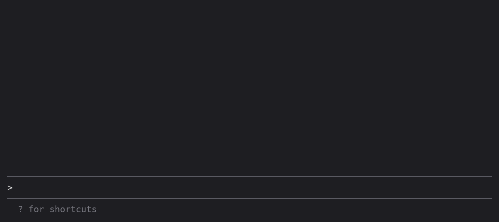

# clawd-guard

[](https://github.com/itsomidho/clawd-guard/releases)

A safety net for [Claude Code](https://claude.com/claude-code). Before Claude runs a shell command or writes a file, clawd-guard checks it. A risky call is either **blocked** or **put to you for approval**, with a one-line reason.



- **Shell:** `rm -rf` on `/`, home, the project or anything outside it · force-push to `main`/`master` · deleting a protected branch · `git reset --hard`, `git clean -f` or `git checkout -- .` while you have uncommitted changes · `DROP`, `TRUNCATE` and `DELETE` without `WHERE` · `chmod 777` · `curl … | sh` · `wp db reset`, `wp search-replace` without `--dry-run` · `docker compose down -v` and other volume deletes
- **Hidden commands:** what runs inside `bash -c "…"`, `eval`, `$(…)`, backticks and `xargs` is checked too, and `find -delete` counts as `rm -r` on the paths it searches.
- **Files:** `.env*`, private keys, `.netrc` and `.git/` are never written. Lockfiles ask first.
- **Secrets:** what Claude writes and what it commits (the staged diff) is scanned for AWS, GitHub, GitLab, Anthropic, OpenAI, Slack, Stripe, Google and npm keys, private keys and hard-coded passwords. The secret itself is never echoed back.
- **Feedback:** a toast when something is stopped, plus a band above the prompt, framed like [clawd-statusbar](https://github.com/itsomidho/clawd-statusbar)'s section, with the last catch: a `BLOCKED` or `ASKED YOU` chip, why, what set it off (the command, or the tool), the rule, and the session's counts. Paths are shown in full (`~` for your home folder); when the line is too long, the middle of the path is cut so its file name stays.

It also covers subagents' calls.

## Install

In Claude Code, type:

```
/plugin install clawd-guard --marketplace itsomidho/claude-plugins
```

## Rules

| Rule | Default |
|---|---|
| `rm-rf-root`: `rm -r` (or `find -delete`, `find -exec rm -r`) on `/`, `~`, `$HOME` or the project root | deny |
| `rm-rf-outside`: the same outside the project (`/tmp` is fine), on a `$VARIABLE`, or `xargs rm -r` fed by anything but `find` | ask |
| `git-force-push-protected`: force-push to a protected branch | deny |
| `git-force-push`: any other force-push | ask |
| `git-push-delete-protected`: `git push --delete main` | deny |
| `git-discard-dirty`: reset --hard / clean -f / checkout -- . / restore . / stash drop, with uncommitted changes | ask |
| `sql-destructive`: DROP, TRUNCATE, DELETE without WHERE, `dropdb` | ask |
| `chmod-world-writable`: `chmod 777`, `o+w` | ask |
| `pipe-to-shell`: `curl`/`wget` piped into a shell | ask |
| `wp-destructive`: `wp db reset/drop/clean/import`, `wp site empty/delete`, `wp search-replace` without `--dry-run` or `--export`; also through `docker`, `ddev`, `lando` or `vendor/bin/wp` | ask |
| `docker-data-loss`: `docker compose down -v`, `docker volume rm/prune`, `docker system prune --volumes`, `ddev delete`, `lando destroy` | ask |
| `protected-file`: writing a protected path (see below) | per path |
| `secret-high`: a known key format | deny |
| `secret-generic`: `password = "…"`-style assignments | ask |

Each rule can be set to `deny`, `ask` or `off`.

## Configure

Settings are read on every check, so an edit applies at once. Files are read in this order, and later ones win:

1. the built-in defaults
2. `~/.claude/clawd-guard.json` (yours, for every project)
3. `<project>/.claude/clawd-guard.json` (the project's; commit it to share it with your team)

```json
{
  "rules": { "sql-destructive": "deny", "chmod-world-writable": "off" },
  "protectedBranches": ["main", "develop"],
  "protect": [
    { "pattern": "config/secrets/**", "action": "deny" },
    { "pattern": "composer.lock", "action": "off" }
  ],
  "allowPaths": [".env.testing"],
  "rmAllowPaths": ["/var/www/cache/**"]
}
```

- `rules`: merged per rule.
- `protect`: an entry with the same `pattern` replaces the default, so `"off"` lifts it. A pattern with no `/` matches the file name in any folder, and one with a `/` matches from the project root. `*`, `**` and `?` work.
- `allowPaths`, `rmAllowPaths`: added to the defaults.
- `protectedBranches`: replaces the default list (`main`, `master`, `production`, `release`).

**A false alarm on a secret?** Put `guard:allow` in a comment on that line.

## Commands

- `/guard`: status, counters, which config files are in use, and the rules in effect
- `/guard off` / `/guard on`: pause or resume checking for this session
- `/guard reset`: zero the counters

## Good to know

- **"Ask" goes to whoever approves in your permission mode.** That's the dialog in default mode. In auto mode it's the classifier, so set a rule to `deny` if it must never run unattended.
- **clawd-guard only tightens.** It never allows a call that your settings or permission rules refuse.
- **It reads commands, it doesn't run a shell.** It splits the line at `;`, `&&`, `||` and `|`, and looks through `sudo` and `env`. A command hidden behind `eval`, a script file or an alias goes past it. Treat it as a seatbelt, not a sandbox.
- **If the guard itself fails,** the call is refused with a message saying so, and `/guard off` gets you going again.
- **Other plugins can read its counters:** clawd-statusbar or any other plugin can read `clawd-guard.denied`, `clawd-guard.asked` and `clawd-guard.last` from `$.state`.

## License

MIT
